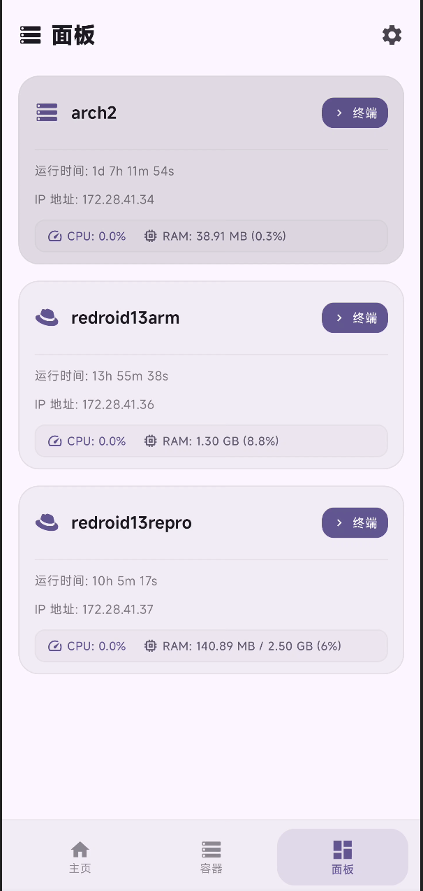

# ARM64 ReDroid 13 on Droidspaces

在 **骁龙 8+ Gen 1（SM8475）/ Adreno 730、Android API 35 真机**上，用 Droidspaces v7.2.0 运行 ARM64 ReDroid 13 的实验记录、源码补丁与复现材料。

仓库记录已经在真机跑通的组合，保留硬件、内核、厂商库和安全隔离方面的适用条件。现在提供当前机型的空数据完整镜像和预编译工具；这是 Droidspaces 容器文件系统，不是通用手机刷机包。

**无需先编译：[下载 v2026.11.28-arm64](https://github.com/washsky/redroid-droidspaces/releases/tag/v2026.11.28-arm64) · [下载、校验与部署步骤](docs/PREBUILT_RELEASES.md)**。包含12 GiB逻辑大小的ARM64镜像（压缩约584 MiB）、工具、管理APK和逐文件清单。先核对mondrian/SM8475及ROM条件；第三方Next/LSPosed不预装。

## 第一部分：核心复现

本项目的核心是 **Droidspaces 成功运行 ARM64 ReDroid，以及必要的基础环境配置**。先完成启动、DHCP、普通应用、联网兼容和所需图形栈；下文保留这一成功基线及历史验收。

第一部分已验证基准提交为[fd3892d](https://github.com/washsky/redroid-droidspaces/tree/fd3892d981dfe989a74a11a5523ff1d7a21d4fc4)。需要重放当时完整源码/配置时可单独检出该版本；当前main同时收录后续补充源码。核心配置仍用config/container.example.conf，第二部分另用config/container.arm13-part2.example.conf，不把cap-init设为核心首次启动的前置条件。

Magisk 深入完整化、Zygisk/Xposed、原版 scrcpy 优化、统一代理和管理前端增强归入独立的第二部分，不是首次启动 Android 的前置条件。

### 核心结果

| 功能 | 实际验收 | 边界 |
|---|---|---|
| Android 13 / ARM64 启动 | 完整启动、目标容器冷启动、DHCP | 仅操作目标容器 |
| 普通 APK | 安装、私有存储、SharedMemory、HTTPS 200 | 默认 TLS 校验保留 |
| 普通应用联网 | 游戏到登录入口；TCP/UDP；网络曾获得 VALIDATED | 通过 UID socket broker；原生应用 UID 直连隔离仍有缺口 |
| UID 网络管理前端 | Android 原生管理 APK，多包选择、保存、状态与重启 | 包名动态解析 UID；需容器内 root |
| Root | 容器内 Bootless Magisk 31.1 基础 root | 完整模块与 Zygisk/LSPosed 为[第二部分补充](docs/PART2_SUPPLEMENT.md) |
| GPU | Mesa Turnip/KGSL、ANGLE、HWUI skiavk | 不是只看 GPU 使用率；不等于全部应用/格式已兼容 |
| H.264 / H.265 | QTI YUV 硬件编解码探针 | 每类 30 帧的历史验收 |
| scrcpy H.264 Surface 硬编 | 早期定制 server + 线性 Surface；arm 后续支持 stock server | [第二部分](docs/part2/SCRCPY_TERMINAL_DISPLAY.md)记录免定制改进；不是零拷贝保证 |
| Via / X 浏览器 | 页面、WebGL 2、滚动、点击、输入、HTTPS | 修复 QTI Gralloc 漏解锁后验收 |
| 脚本应用 | root 截屏/虚拟显示、配置页、停止操作 | 无障碍需开启；未验收自动游戏流程 |
| 存储 | 6 GiB → 12 GiB，离线文件系统检查通过 | 余量随应用数据变化，见状态快照 |

**未完成：** 原生 UID 网络隔离根治、通用硬件/ROM 兼容、全部应用 Surface 编解码、一小时耐久与游戏登录后流程、从空源码环境完整重建验收。

2026-11-24 已新增一个空数据独立容器，复用产物完成首次部署与冷启动验收，并修复公开构建的管理 APK 的预加载命名空间问题：[实际复现结果](docs/REPRODUCTION_20261124.md) · [跳过大型编译的步骤](docs/PREBUILT_REPRODUCTION.md)。

## 第二部分：功能补充与兼容性探索

2026-11-24/25 先在原成功环境 redroid13arm 上追加，再经用户明确授权，在 redroid13repro 的既有独立部署基线上完成[第二部分增量复现](docs/part2/REPRODUCTION_REPRO_20261125.md)。复用大型编译产物，跳过已验收的基础 Magisk 模块生命周期；本轮只重启 repro，arm、arch2 和真机保持运行。

- **[第二部分总览、范围与实例状态](docs/PART2_SUPPLEMENT.md)**
- **[重点：Magisk 完整化与 Zygisk Next 1.5.3 + LSPosed 2.2.1](docs/part2/MAGISK_ZYGISK_LSPOSED.md)**：安装、身份/命名空间、SCM_RIGHTS、noexec、真实回调，以及给 x86 的排障检查表。
- [原版 scrcpy、终端、显示启动参数与能力收紧](docs/part2/SCRCPY_TERMINAL_DISPLAY.md)
- [UID 管理器 v1.2、统一 TCP/UDP/DNS 代理和认证](docs/part2/PROXY_AND_MANAGER.md)
- [补充部署、验证与回退](docs/part2/REPRODUCTION_AND_VALIDATION.md)
- [repro 实际复现与验收、管理控制器改为每容器配置](docs/part2/REPRODUCTION_REPRO_20261125.md)

最终 arm 已验证 Next1.5.3（880-22a1bf5）+ 用户提供的 LSPosed2.2.1（7912）、stock scrcpy5.0.1 QTI编码/VAAPI解码、终端PTY、init显示参数和可选代理。**没有复测 x86、没有实际第三方 Xposed 业务 hook，也没有一小时耐久**；普通应用仍依赖 UID broker。详情和输入/运行哈希见[脱敏摘要](evidence/2026-11-25-supplement/README.md)与[产物清单](artifacts/supplement-20261125.json)。

## 第一部分详细阅读入口

1. [完整过程与复现指南](docs/FULL_PROCESS.md)
2. [维护者 / 下一位 AI 交接](docs/HANDOFF.md)
3. [当前状态与验收矩阵](docs/STATUS.md)
4. [AOSP 源码和镜像构建](docs/BUILD.md)
5. [应用 UID 联网与管理器](docs/NETWORK.md)
6. [GPU、Gralloc 和硬件视频](docs/GRAPHICS.md)
7. [Root 与安全边界](docs/ROOT_AND_SECURITY.md)
8. [扩容与回退](docs/STORAGE_AND_ROLLBACK.md)
9. [验证步骤](docs/VALIDATION.md)
10. [时间线、失败路径与经验](docs/EXPERIMENT_LOG.md)
11. [重建边界与已知缺口](docs/REPRODUCIBILITY_GAPS.md)
12. [上游、许可证与未分发文件](THIRD_PARTY.md)

## 仓库内容

- `src/`：实际实验使用的 C / C++ / Java 源码；保留上游版权头。
- `patches/aosp/`：当前编译树相对于各项目 HEAD 的补丁与基线 SHA。
- `aosp-manifest-pinned.xml`：源码项目的 pinned manifest；未提交的改动另外保存。
- `patches/mesa/`：基于固定 Mesa for Android Container 版本的改动和新增文件。
- `patches/scrcpy/`：针对 scrcpy 5.0.1 的 server 补丁。
- `config/`：init、服务和容器配置参考；不能不加检查地覆盖现有系统。
- `scripts/`：构建、离线补丁、只读检查、扩容工具。
- `evidence/`：脱敏后的对照日志和真实画面。
- `docs/HANDOFF.md`：已验证文件、哈希、保护约束和下一步。

开始前复制 `config/lab.env.example` 为本地 `lab.env`，填入自己的路径和 ADB 目标。**所有 ADB 命令必须指定 `-s`**。

## 重要适用条件

- 第一部分基线曾使用 `privileged=full`；第二部分 arm 改为 `nocaps` + 自定义 init 删五项能力，仍无 root UID 映射、仍保留36项能力，并非最小权限或真正非特权 userns。宿主侧已有的容器 SELinux 兼容策略及 `persist.zygote.app_data_isolation=false` 仍是边界。宿主 `getenforce` 保持 Enforcing，**不能因此声称容器隔离与原生 Android 安全等价**。
- 不要全局关闭 SELinux、解绑宿主 cgroup eBPF、清空防火墙，或暴露全部宿主设备。
- Git源码树保存补丁与记录；[Release](docs/PREBUILT_RELEASES.md)另外提供包含当前ROM厂商库、WebView和历史Magisk输入的完整空数据镜像，以及独立工具/APK。它不含账号、ADB密钥、签名私钥、模块license或Magisk授权数据库。分发来源和历史二进制缺口见[THIRD_PARTY.md](THIRD_PARTY.md)。
- QTI Gralloc 二进制修补只接受一个精确 SHA256，输出到新文件；不是可套用到其他手机的通用偏移补丁。
- 旧交接中的“骁龙 7+ Gen 2”“仍全程 SwiftShader”“DHCP 源码补丁未部署”等结论已经过时；本仓库以实际文件和分阶段验收为准。

整理更新：2026-11-28（Asia/Shanghai）。第一部分核心验收主要完成于11-21至11-24；第二部分增量验收于11-24/25；11-28新增空数据镜像的实际部署、模块冷启动及下载发布验收。

